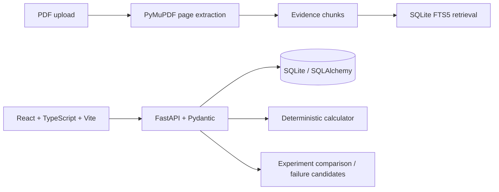

# Lab Process RAG

Lab Process RAG is an evidence-aware experimental process design and troubleshooting workspace. It searches supplied papers, preserves page provenance, compares recorded process variables, and lets Gemma answer both from uploaded sources and from general scientific knowledge. Each answer separates `SUPPORTED`/`INFERRED` paper claims from `MODEL_KNOWLEDGE`; users can turn general knowledge off for a paper-only answer. Calculations, comparisons, failure candidates, and citation checks remain application code rather than LLM decisions.

## Architecture



`RetrievalProvider` isolates retrieval behind an interface so an embedding provider can be added later without binding the app to a hosted vector database. Claims have `SUPPORTED`, `INFERRED`, `MODEL_KNOWLEDGE`, and `UNKNOWN` states. SUPPORTED and INFERRED require at least one evidence ID; MODEL_KNOWLEDGE cannot carry paper citations. Synthetic experiment records use `demo=true` and visible `DEMO DATA` labeling; they are not paper evidence.

Paper search follows a staged workflow: compact, source-linked summaries help find candidate papers; the summary index then retrieves original page excerpts for the answer. The model receives a bounded set of those excerpts, not every uploaded paper. If relevant evidence is still missing, the assistant explains the gap and suggests search terms; Crossref discovery returns DOI and available publisher links. Add an accessible PDF through the Papers upload to index it locally. General Gemma knowledge can fill conceptual gaps when enabled and is labeled separately from paper-backed claims.

## 현재 실험 기록 및 종합 분석 흐름

연구는 **연구 주제 → 실험 방법/공정 버전 → 개별 실험 실행 → 주제 최종 종합 분석** 순서로 기록합니다.

1. **큰 연구 주제를 선택합니다.** 하나의 연구 목표 아래 여러 실험 방법과 공정 버전을 관리합니다.
2. **실험 방법을 공정 단계와 조건 박스로 정의합니다.** 공통 절차는 방법에 저장하고, 실제 실행마다 달라지는 온도·시간·농도·재료량은 실행 기록에 입력합니다. 기존 방법의 단계 순서가 달라진 실험은 별도 공정 버전으로 구분합니다.
3. **실험을 실행할 때 날짜, 진행 시간, 실제 조건, 재료, 단계별 관찰과 결과를 기록합니다.** 결과 항목에 `분석 필요`를 선택하면 장비 종류, 분석 도구, 원본 측정 파일, 관련 공정 단계를 연결합니다.
4. **실행 기록을 저장하면 연결한 파일을 처리합니다.** 지금 연결된 결정론적 파일 분석은 계산된 관찰값과 원본 파일·체크섬을 보존합니다. 어댑터가 아직 없는 전문 장비는 분석 대기 상태로 기록됩니다.
5. **실험을 모은 뒤 Analysis에서 `연구 주제 전체 종합 분석`을 한 번 실행합니다.** 해당 주제의 모든 실험 기록과 분석 완료된 측정 결과가 함께 전달됩니다. 같은 공정 내 조건 변경과 공정 버전 간 차이는 구분해서 검토합니다. 장비 분석이 대기 중인 파일은 종합 설명에 포함되지 않습니다.
6. **종합 결과를 검토하고 다음 실험을 직접 정합니다.** Gemma 설명, 계산된 측정 관찰, 사용한 논문 근거, 남은 근거/측정 공백은 구분해 표시합니다. 결과를 원인 증명이나 자동 공정 처방으로 취급하지 않습니다.

실행 및 중간 단계의 파일 첨부는 개별 실험 기록에 남고, 최종 통합 분석은 연구 주제 범위에서 수행됩니다. 따라서 같은 연구 주제 안의 여러 방법을 함께 검토하면서도 각각의 공정과 실행 기록의 출처를 추적할 수 있습니다.

## Backend

```bash
cd backend
python3 -m venv .venv
source .venv/bin/activate
pip install -r requirements.txt
uvicorn app.main:app --reload
```

SQLite is created automatically at `data/lab_process.db` on startup. API docs: http://localhost:8000/docs. Seed the six synthetic examples with `POST /api/demo/seed`.

## Frontend

For normal use on this Mac, the production frontend is served by FastAPI at **http://localhost:8000/**, alongside the API. Save that address as a browser bookmark. The macOS LaunchAgents installed by `python3 scripts/install-local-services.py` start both the app and Ollama when you log in. Gemma runs locally through Ollama; it is not executed inside the HTML page. The LaunchAgents bind only to this Mac (`127.0.0.1`).

```bash
cd frontend
npm install
npm run dev
```

The Vite development server is optional for development. Build with `npm run build`; FastAPI serves the generated `frontend/dist` files in normal use.

## Tests

```bash
cd backend
PYTHONPATH=. pytest
```

The tests cover evidence claim validation, calculator conversions, variable comparison, failure candidate wording, and API health. A PDF page/chunk integration fixture can be added alongside user supplied sample PDFs; no external paper is bundled.

## Demo dataset

The seeded six records include three successes, two failures, and one partial success. Every demo record has `demo=true` and its note says it is synthetic. Values illustrate comparison behavior only and must not be treated as scientific recommendations.

## Paper upload and search

Upload a PDF using `POST /api/papers` as multipart form data (`file`, with optional `title`, `authors`, `year`). PyMuPDF extracts page text into evidence chunks with paper and page IDs. Search using `GET /api/search?q=...` or `POST /api/search`. Search results contain evidence ID, paper title, page, section when identified, original text, and a retrieval score. Local SQLite FTS5 is used where available with a simple fallback.

## Evidence policy

- Every technical claim must have evidence IDs when marked SUPPORTED or INFERRED.
- UNKNOWN can have no evidence and cannot be silently filled using general model knowledge.
- Recorded differences are candidate variables for investigation, not proof of causation.
- The demo dataset is synthetic and distinct from supplied papers and laboratory data.
- The deterministic calculator reports its formula and normalized substitution. It is arithmetic, not experimental evidence.

## V0.1 limitations / next steps

- Section detection is heuristic; PDF extraction cannot recover text absent from the document layer (for example, scanned images without OCR).
- Unit normalization in experiment comparison currently detects exact recorded values and units; conversion is currently implemented for calculator inputs, not arbitrary process variable comparisons.
- Design endpoint returns matching supplied evidence and an empty process candidate rather than claiming an autonomous design.
- CSV import, evidence linking on individual graph variables, editable multi-step UI, OCR, richer lab-evidence retrieval, and controlled variable aliases are follow-up work.

## Optional local AI and model survey

The **Assistant** panel uses Gemma 4 12B through a local Ollama server. The current local `.env` enables Ollama with `OLLAMA_MODEL=gemma4:12b`; on another machine, install Ollama and pull that model before enabling the provider. The assistant only receives a bounded set of retrieved paper excerpts and its evidence IDs are validated before return.

See [Open-weight model survey](docs/OPEN_WEIGHT_MODELS_2026.md) for the brand-by-brand open-weight survey and Mac shortlist, and [AI architecture](docs/AI_ARCHITECTURE.md) for model roles, privacy boundaries, and evaluation approach.

## Instrument analysis pilot

While recording an experiment run, mark a result as needing analysis and attach its small test export, instrument type, tool, and (optionally) process step. The Analysis page is for topic-wide review and synthesis; it does not have a separate measurement upload queue. Each original file, SHA-256 checksum, run settings, tool ID, and result are kept in local SQLite/files. Current pilot tools are deliberately limited:

- XRD `.xy`, `.xye`, `.csv`, `.txt`, or `.dat`: reports observed local peak candidates; it does not identify phases or perform Rietveld refinement.
- AFM rectangular numeric height grids (`.csv`, `.txt`, `.dat`): removes a best-fit plane and reports Sa, Sq, and Sz in the supplied height unit.
- SEM/TEM PNG/JPEG/TIFF: creates an exploratory Otsu threshold mask and component-area summary using the supplied nm/pixel scale. This is not a trained microscopy model and requires visual review.

The `/api/analysis/tools` registry lists specialist candidates for future instrument-format adapters: GSAS-II for diffraction refinement, Gwyddion for SPM/AFM, HyperSpy/eXSpy for EDS/EELS, py4DSTEM/LiberTEM for 4D-STEM, and ilastik for user-labeled image segmentation. Those workflows are currently marked as planned, not installed or presented as working integrations. Add them when actual instrument files and analysis targets are available. Analysis observations do not automatically become paper evidence or causal claims.

## Run through the requested user flow

1. Start the backend and frontend as above.
2. Choose **Load demo data** in the dashboard; six marked records are stored in SQLite.
3. Select an experiment in the process graph and inspect its recorded variables.
4. In Experiments, compare records and inspect recorded differences.
5. In Overview, select a failed or partial record and run failure analysis. The output calls variables candidates and explicitly says it does not establish causation.
6. Upload a supplied paper in Papers, then search its extracted text. Each excerpt shows its paper title and page.
7. While recording an experiment run, add measurement files to result rows marked **Analysis needed**. The Analysis page lists measurements across the topic; after collecting runs, select **Analyze the entire research topic** to review completed measurements and all topic experiment records together. Pending specialist-tool formats are clearly excluded until an adapter is available.
8. In Calculator, calculate the amount from concentration and volume. The API also exposes mass, dilution, and molar ratio endpoints.

All endpoints are under `/api`; OpenAPI interactive docs at `/docs` list their input schemas.
