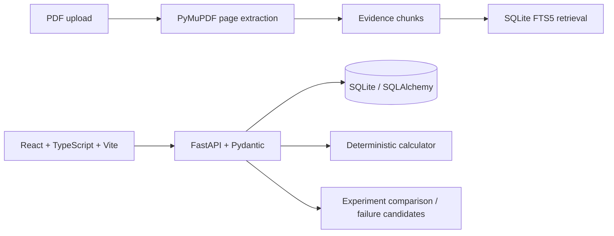

# Lab Process RAG

**No Evidence → No Claim.** Lab Process RAG is an evidence constrained experimental process design and troubleshooting workspace. It searches supplied papers and recorded lab experiments, preserves paper page provenance, compares recorded process variables, and reports unknowns instead of filling gaps with pretrained scientific knowledge. It does not include an LLM planner in V0.1.

## Architecture



`RetrievalProvider` isolates retrieval behind an interface so an embedding provider can be added later without binding the app to a hosted vector database. Claims have `SUPPORTED`, `INFERRED`, and `UNKNOWN` states. SUPPORTED and INFERRED require at least one evidence ID by schema validation. Synthetic experiment records use `demo=true` and visible `DEMO DATA` labeling; they are not paper evidence.

## Backend

```bash
cd backend
python3 -m venv .venv
source .venv/bin/activate
pip install -r requirements.txt
uvicorn app.main:app --reload
```

SQLite is created automatically at `data/lab_process.db` on startup. API docs: http://localhost:8000/docs. Seed the six synthetic examples with `POST /api/demo/seed`.

## Frontend

```bash
cd frontend
npm install
npm run dev
```

Open http://localhost:5173. Vite proxies `/api` to the backend. Build with `npm run build`.

## Tests

```bash
cd backend
PYTHONPATH=. pytest
```

The tests cover evidence claim validation, calculator conversions, variable comparison, failure candidate wording, and API health. A PDF page/chunk integration fixture can be added alongside user supplied sample PDFs; no external paper is bundled.

## Demo dataset

The seeded six records include three successes, two failures, and one partial success. Every demo record has `demo=true` and its note says it is synthetic. Values illustrate comparison behavior only and must not be treated as scientific recommendations.

## Paper upload and search

Upload a PDF using `POST /api/papers` as multipart form data (`file`, with optional `title`, `authors`, `year`). PyMuPDF extracts page text into evidence chunks with paper and page IDs. Search using `GET /api/search?q=...` or `POST /api/search`. Search results contain evidence ID, paper title, page, section when identified, original text, and a retrieval score. Local SQLite FTS5 is used where available with a simple fallback.

## Evidence policy

- Every technical claim must have evidence IDs when marked SUPPORTED or INFERRED.
- UNKNOWN can have no evidence and cannot be silently filled using general model knowledge.
- Recorded differences are candidate variables for investigation, not proof of causation.
- The demo dataset is synthetic and distinct from supplied papers and laboratory data.
- The deterministic calculator reports its formula and normalized substitution. It is arithmetic, not experimental evidence.

## V0.1 limitations / next steps

- Section detection is heuristic; PDF extraction cannot recover text absent from the document layer (for example, scanned images without OCR).
- Unit normalization in experiment comparison currently detects exact recorded values and units; conversion is currently implemented for calculator inputs, not arbitrary process variable comparisons.
- Design endpoint returns matching supplied evidence and an empty process candidate rather than claiming an autonomous design.
- CSV import, evidence linking on individual graph variables, editable multi-step UI, OCR, richer lab-evidence retrieval, and controlled variable aliases are follow-up work.

## Run through the requested user flow

1. Start the backend and frontend as above.
2. Choose **Load demo data** in the dashboard; six marked records are stored in SQLite.
3. Select an experiment in the process graph and inspect its recorded variables.
4. In Experiments, compare records and inspect recorded differences.
5. In Overview, select a failed or partial record and run failure analysis. The output calls variables candidates and explicitly says it does not establish causation.
6. Upload a supplied paper in Papers, then search its extracted text. Each excerpt shows its paper title and page.
7. In Calculator, calculate the amount from concentration and volume. The API also exposes mass, dilution, and molar ratio endpoints.

All endpoints are under `/api`; OpenAPI interactive docs at `/docs` list their input schemas.
