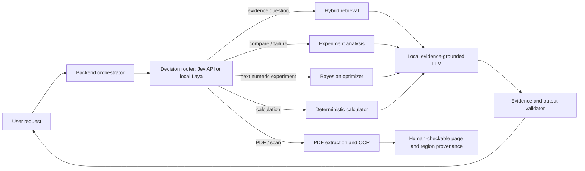

# Lab Process RAG: AI integration architecture

## Recommendation

Add AI as a set of bounded specialists behind a backend orchestrator. Keep evidence retrieval, provenance, claim validation, and arithmetic in explicit services. A decision model such as Jev can route a request to a service; it should not be the evidence source, scientific authority, or free-form multi-agent controller.

The orchestrator should own tool permissions, timeouts, retries, request state, and provenance. The router returns only an allowed route and confidence/abstention metadata. Each specialist returns a typed result with its source identifiers. The final answer generator receives those results and their evidence IDs; a deterministic validator rejects supported or inferred claims with missing or nonexistent citations.

For XRD, AFM, TEM, and SEM, instrument-specific numerical analysis is a separate tool family from text generation. The current `Analysis` pilot runs deterministic XRD local-peak, AFM plane-level roughness, and global-threshold microscopy previews. Every run stores an original file, SHA-256 checksum, tool ID, and structured output. These previews are not trained scientific models, and they require human review. The registry lists specialist software as planned until real instrument exports are available.

## AI types that fit this system

| Type | Place in Lab Process RAG | Candidate approach | Recommendation |
|---|---|---|---|
| Request router / typed decision model | Choose which existing service should handle an incoming request; optionally route independent subquestions | Jev hosted decision API; Laya open-weight and locally runnable decision model | Useful as a small switchboard. Keep the route list fixed in backend code and let Jev/Laya choose only among those routes. Jev is an external API; Laya is a local alternative whose quality must be measured on our domain. |
| Tool-using agent / workflow orchestrator | Carry a request across retrieval, comparison, calculator, optimizer, and answer generation; combine their typed results | Backend-owned state machine or a graph workflow such as LangGraph, with a router model as one optional node | Needed to connect specialists, but keep the workflow and allowed calls in application code. A language model can request a permitted step; it must not get unrestricted database, shell, or arbitrary-tool access. |
| Embedding model | Find semantically related papers and experiments when exact keyword search misses wording variants | BGE-M3 is multilingual and supports dense, sparse, and multi-vector retrieval | Add behind the existing `RetrievalProvider`; preserve SQLite FTS/BM25 and combine lexical and vector candidates. This is the highest-value RAG improvement after establishing a labeled search set. |
| Reranker | Reorder the first-stage search results so the most relevant evidence appears first | A multilingual cross-encoder such as BGE reranker v2 M3 or GTE multilingual reranker | Add after hybrid retrieval, not instead of retrieval. Reranking selects passages; it does not establish that a passage supports a claim. |
| Generative LLM | Turn retrieved evidence into a readable answer or ask for missing information | Gemma 4 12B via local Ollama (selected by user) | Use JSON/schema output, per-claim evidence IDs, a validator, and an UNKNOWN/abstain path. The model must not calculate numerical results, measure instrument data, or invent citations. |
| OCR and document-layout model | Read scanned PDFs, tables, equations, and page regions that PyMuPDF text extraction misses | Docling's local document pipeline with OCR and table-structure options | Useful because V0.1 currently extracts only the PDF text layer. Store page, region, and extraction method with every resulting evidence item; keep extracted OCR text distinguishable from native text and require review for ambiguous tables/equations. |
| Structured extraction model | Convert papers or lab notes into proposed variables, units, outcomes, and process steps | Constrained LLM extraction to a typed schema, followed by deterministic unit and provenance validation | Add after OCR and evidence linking. Treat every extraction as a draft requiring a quoted source span/page; do not silently write extracted values into experiment records. |
| Bayesian optimization / active learning | Recommend the next numerical experiment from a defined variable space, objectives, constraints, and recorded outcomes | BayBE; BASIL is a separate GUI product built around BayBE and useful as a workflow reference | Appropriate for a later experiment-planning feature. It is fundamentally different from Jev: it optimizes structured experimental outcomes rather than routing language requests. Do not activate on synthetic demo records. |
| Time-series / anomaly models | Detect abnormal sensor trajectories, drift, or process deviations | Classical statistical baselines first, then a suitable forecasting/anomaly model once sensor data exists | Not useful yet: V0.1 contains hand-recorded experiment records rather than timestamped sensor streams. |
| Scientific instrument analysis | Process XRD patterns, AFM topography, TEM/SEM imagery, and spectra | Current pilot: deterministic previews. Planned format-specific adapters: GSAS-II, Gwyddion, HyperSpy/eXSpy, py4DSTEM/LiberTEM, ilastik | Preserve original binary data and metadata; store software/version, settings, calibration, units, masks, and uncertainty. Promote values into accepted experiment results only after review. Do not ask an LLM to infer measurements from pixels. |
| Vision / multimodal LLM | Explain an already computed, reviewable visual observation or answer questions about an image | Gemma 4 12B is multimodal, but no image-analysis route is currently wired into the pilot | Optional explanation only. Keep image observations linked to the original image/run and require human confirmation for numerical values or causes. |
| Speech recognition | Transcribe spoken lab notes or dictate observations | Optional local speech-to-text model | Not needed for the current PDF, experiment, and search workflows. Add only if voice capture becomes a product requirement. |
| Deterministic/statistical services | Unit conversion, formula evaluation, schema/range checks, citation existence, simple comparisons | Existing Python services plus explicit statistical libraries where appropriate | Keep these as code, not as an LLM task. The current calculator and evidence status validator should remain authoritative for their domains. |

Jev's own API describes typed `choice`, `score`, and yes/no (`noul`) decisions. It does not execute the selected tool; the application must do that. Laya follows a similar typed-decision pattern and can be run locally. Their confidence values are useful routing signals, not guarantees of correctness.

## Fit to the current code

V0.1 already has the right boundaries to extend:

- `app/services/retrieval/provider.py` has a `RetrievalProvider` interface. Add hybrid lexical/vector search here and keep evidence formatting with IDs, page, and paper metadata.
- `app/services/ingestion/pdf.py` is the current text-layer PDF path. Add a separate OCR/layout provider and preserve page/region provenance instead of replacing the existing path.
- `app/services/evidence/claims.py` and the `Claim` schema enforce evidence IDs. Extend validation to check IDs against the database before returning claims.
- `app/services/calculator/service.py` remains the only path for numeric formula results.
- `app/services/experiment/compare.py` and `app/services/failure_analysis/service.py` provide structured observations. A language model may explain these observations, but should preserve the current UNKNOWN/no-causation wording.
- `backend/app/services/llm.py` provides an optional Ollama-compatible local generation adapter. `AI_PROVIDER` defaults to `disabled`; set an explicit `OLLAMA_MODEL` only after selecting a model. The assistant can use general knowledge when the user enables it, but marks those claims `MODEL_KNOWLEDGE` with no paper citations. Paper-backed claims remain `SUPPORTED` or `INFERRED` and must cite retrieved IDs; citation identity is checked, but entailment still needs human review.
- PDF ingestion keeps page-level source chunks and creates a compact Gemma summary from selected excerpts, with links back to the original chunk IDs. The FTS retrieval path searches summaries first to locate candidate papers, then returns original full-text passages for the answer context. It does not load every paper into the model context. Summary matches guide retrieval; answer citations point to source pages.
- Assistant responses can report specific evidence gaps and focused search queries. `GET /api/papers/discover?q=...` searches Crossref metadata; DOI and publisher-provided PDF links help the user obtain a paper, and the user adds an accessible PDF through the existing upload flow. Crossref records are discovery metadata, not indexed scientific evidence.
- Add a distinct orchestration service that routes to these existing modules; do not make agents call arbitrary tools or each other directly.
- `app/services/material_analysis/service.py` implements tested pilot analyzers. `GET /api/analysis/tools` describes ready pilots and planned specialist adapters. `POST /api/analysis/run` stores input files under ignored local runtime data and persists checksummed output in `material_analysis_runs`. `/analysis/runs` exposes run history and routes serve saved originals and masks.
- Pilot scope is intentionally narrow: XRD reports sampled local maxima, AFM expects a numeric rectangular height grid, and SEM/TEM accepts raster PNG/JPEG/TIFF with a user-supplied nm-per-pixel scale for an Otsu preview. These outputs are not phase IDs, trained object masks, or causal conclusions.
- The selected local model tag is `gemma4:12b`; `AI_PROVIDER=ollama` enables the local research assistant. Do not expose analysis outputs as paper evidence unless they are modeled as a separate provenance-aware observation type and validated explicitly.

## Suggested rollout

1. **AI adapter and routing contract:** define route names, structured inputs/outputs, timeouts, abstention, and provider selection. Start with deterministic routing rules so the app works without credentials. Add Jev as an optional router adapter and Laya as the local adapter only after comparing both on the same labeled requests.
2. **Better retrieval:** create a small query-to-relevant-evidence benchmark; add local embeddings and reranking behind `RetrievalProvider`; preserve FTS as fallback and inspect which source page caused each match.
3. **Evidence-grounded answer generation:** add a configurable local LLM. Feed it only retrieved evidence and outputs from trusted services. Require claim-level evidence IDs and validate every ID before display.
4. **OCR and extraction:** test native-text, scanned, table-heavy, and equation-heavy PDFs. Store extraction provenance and make uncertain extractions reviewable before they become lab records.
5. **Experiment optimization:** formalize parameter aliases, units, objective values, safety constraints, and campaign history. Evaluate BayBE on held-out or simulated campaigns; disable it for `demo=true` records.
6. **Instrument files:** add GSAS-II, Gwyddion, HyperSpy/eXSpy, py4DSTEM/LiberTEM, or ilastik adapters in the registry when sample exports, instrument metadata, and target measurements are available. Build format-specific test fixtures and validate numerical outputs against expert-reviewed references.
7. **AI explanation of analyses:** if needed, let Gemma summarize already calculated and reviewed observations with explicit run IDs. It must not perform calibration, phase assignment, numerical measurement, or causal inference on its own.

## Privacy and evidence boundaries

- Jev is hosted, so request state sent to it leaves the Mac. If used, send a minimal routing summary and fixed route choices, not entire PDFs, raw lab notebooks, or secrets. Local Laya avoids that hosted decision call but still needs domain evaluation.
- Keep the generative model local by default while lab data sensitivity is unknown. Provider and model names should be configuration, not hard-coded assumptions.
- A model's probability/confidence is not evidence. Only paper excerpts and recorded experiments with valid provenance can support scientific claims.
- A retrieval score says how well a passage matched the query; it does not say the passage proves a claim.
- Keep synthetic demo data visibly labeled and excluded from model training, evaluation, and experiment optimization unless a benchmark explicitly tests demo behavior.

## Initial evaluation set

Before enabling any AI path, create a small, versioned set of representative Korean and English lab requests, each labeled with:

- intended backend route;
- relevant evidence IDs and page numbers, or `UNKNOWN`;
- allowed claims and forbidden unsupported conclusions;
- expected calculation inputs/outputs where applicable;
- whether a human should review the result.

Compare each AI component with the existing deterministic baseline. Track route accuracy and abstention for routers; recall@k and citation/page correctness for retrieval; answer support and invalid-citation rate for generation; extraction exactness for OCR/structured extraction; and objective improvement plus constraint violations for experimental optimization. Do not promote a component based only on latency or a vendor benchmark.

## References

- [Jev decision API](https://jev-ai.org/docs/)
- [Laya open-weight decision model](https://github.com/NandhaKishorM/laya)
- [BGE-M3 model card](https://huggingface.co/BAAI/bge-m3)
- [BGE reranker v2 M3 model card](https://huggingface.co/BAAI/bge-reranker-v2-m3)
- [Docling pipeline options](https://docling-project.github.io/docling/reference/pipeline_options/)
- [Gemma 4 overview](https://ai.google.dev/gemma/docs/core)
- [OpenAI gpt-oss models](https://openai.com/index/introducing-gpt-oss/)
- [BayBE documentation](https://emdgroup.github.io/baybe/stable/)
- [BASIL project](https://github.com/molecularmodelinglab/BASIL)
